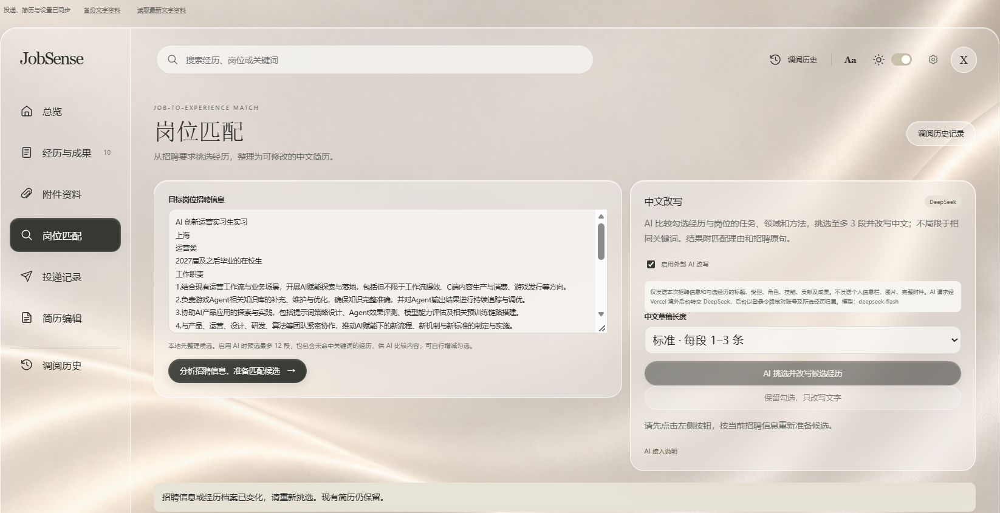
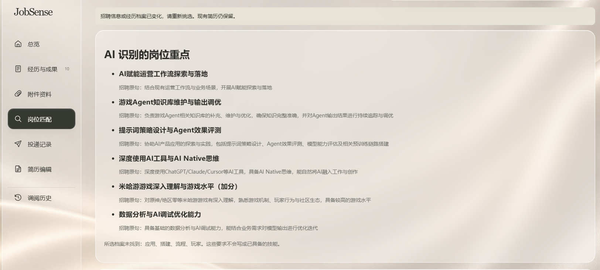
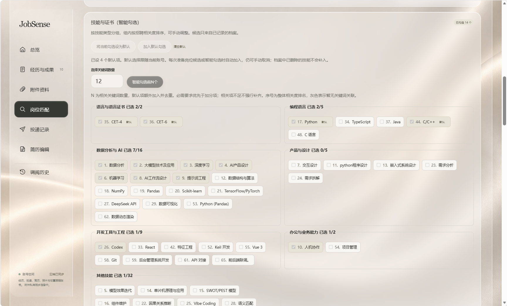
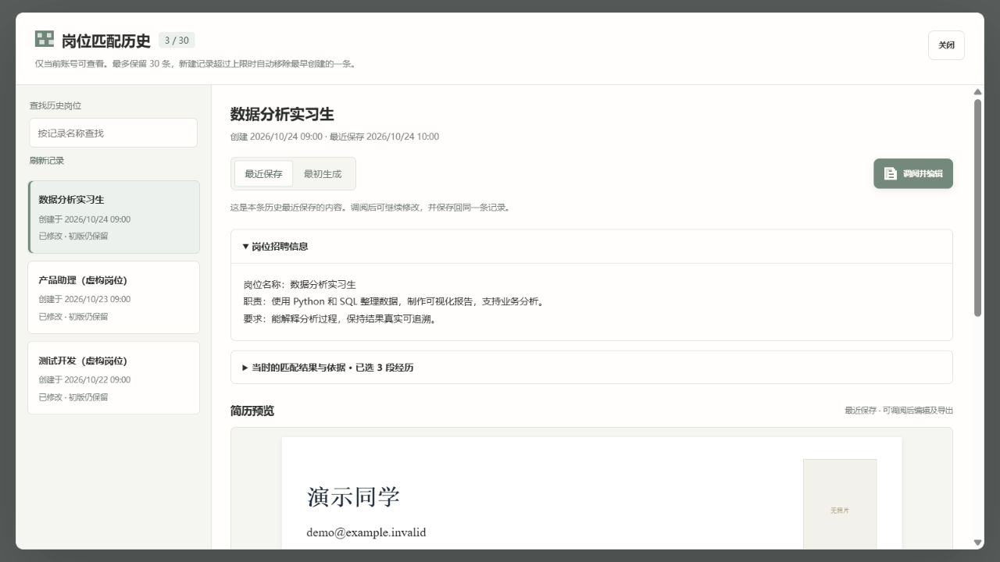
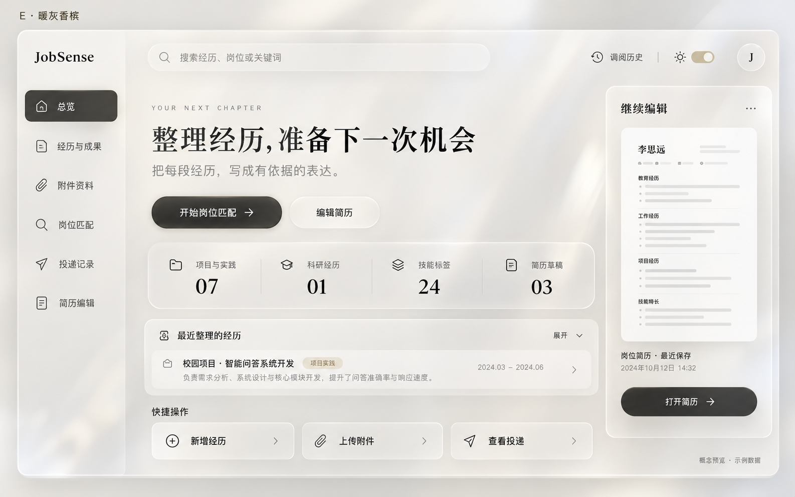

# JobSense

### 把每一段经历，整理成下一次机会。

JobSense 是一款面向求职场景的经历管理与简历助手。记录项目、科研和实习经历，结合岗位需求挑选相关内容，编辑简历并追踪投递进度，让每次准备都有据可查。

React · TypeScript · CloudBase · PostgreSQL · DeepSeek · Vercel

> **当前状态：开发中的源码项目。** 可以克隆或下载源码并在本地体验；账号同步与 AI 需要自行配置服务。云端部署流程仍待完整验证。

## 界面预览

以下是实际使用中的页面截图，展示暖灰香槟主题及岗位匹配流程。

**岗位匹配** · 粘贴目标岗位信息，准备候选经历并选择 AI 改写。



**AI 识别岗位重点** · 展示提取的岗位要点及对应招聘原句，方便核对。



**技能与证书** · 按类别整理，支持按岗位相关度推荐及手动调整。



<details>
<summary>查看更多：岗位历史实装截图与首页设计参考</summary>

**岗位历史界面** · 2026-10-24 的实装截图，使用虚构资料；当前版本视觉样式可能有所变化。



**首页设计概念图** · 暖灰香槟玻璃风格设计参考，使用示例内容；与实际页面可能存在差异。



</details>

## 从经历到投递

1. **建立经历档案**：整理教育、项目、科研和实习经历，记录职责、技能与成果。
2. **匹配目标岗位**：粘贴招聘信息，先按关键词和经历类型准备候选，再使用 DeepSeek 比较与改写。
3. **编辑并导出简历**：保留原文依据，人工确认内容，调整字体和版式，通过浏览器打印或另存 PDF。
4. **跟进投递进度**：记录岗位和申请状态，查看阶段与月份分布；在账号模式下可调阅岗位匹配与简历历史。

## 功能一览

| 模块 | 能做什么 |
| --- | --- |
| 总览 | 查看档案概况、最近经历和当前简历，进入常用操作。 |
| 经历与成果 | 整理教育、项目、科研、实习及实践资料。 |
| 附件资料 | 在本机保存、关联、检索和预览附件。 |
| 岗位匹配 | 根据岗位准备候选经历，辅助比较并生成可编辑草稿。 |
| 投递记录 | 管理申请进度，查看职位类型、阶段与月份统计。 |
| 简历编辑 | 调整栏目、照片、字体与排版，打印或另存 PDF。 |

账号模式可同步经历、当前简历、投递记录、照片和偏好。岗位匹配历史每账号最多保留 30 条，可查看招聘原文、匹配依据、初版与最近修改版，调阅后继续编辑。普通附件原文件目前主要保存在本机。

## 值得关注的实现

- **分层匹配**：关键词加权和按类型轮询用于准备候选，DeepSeek 再进行语义比较；单次最多处理 12 段候选，推荐最多 3 段经历。
- **有依据的改写**：保留原文依据，检查引用、数字及部分职责表述，必要时补回原始量化成果。规则不能替代完整事实核验，生成内容仍需人工确认。
- **账号与同步**：CloudBase 认证配合 PostgreSQL 行级权限限制资料归属，使用版本号处理多设备更新冲突。
- **服务端 AI 接入**：Vercel 函数校验身份并转发请求，DeepSeek 密钥保存在服务端；数据库控制逐账号限额与并发。
- **历史快照**：保留招聘信息、匹配结果与简历版本，支持调阅、修改和保存。

## 获取与本地运行

在仓库页面点击绿色 **Code → Download ZIP** 下载源码；也可以使用 Git 克隆。下载源码后，在项目目录中运行：

```powershell
cd web
pnpm install --frozen-lockfile
pnpm dev
```

浏览器访问终端提示的地址。本地模式使用浏览器存储；如需本地 AI 改写，需要配置自己的 DeepSeek API 密钥。未配置 AI 时，仍可体验经历整理、候选准备、简历编辑和本地投递管理。

```powershell
pnpm test
pnpm build
```

开发和构建脚本会从 PDF.js 依赖复制渲染资源，无需提交生成的 `public/pdf-assets/`。本项目目前提供源码，尚无已验证的一键安装包。

## 账号模式与部署

```text
浏览器工作台
├─ CloudBase 认证与 PostgreSQL：账号身份、私有资料和历史
└─ Vercel AI 函数：身份与归属校验、限额 → DeepSeek API
```

部署者需要自己的 CloudBase 环境、前端来源和 AI 后台地址，以及服务端 DeepSeek 密钥。前端使用 `VITE_CLOUDBASE_ENV_ID`；`web/public/ai-endpoint.json` 需要填写自己的 AI 后台地址。AI 函数运行环境使用 `CLOUDBASE_ENV_ID`、`JOBSENSE_SITE_ORIGIN` 和 `DEEPSEEK_API_KEY`。全新环境还需按数据库脚本的依赖顺序配置表、权限和函数。

完整部署说明、独立环境安全检查与真实账号联调尚待完成；不要把当前源码视为开箱即用的云部署包。

## 验证与使用边界

候选源码安装后，74 项现有自动测试通过，本地模式与账号模式构建成功。此前还运行过 12 项本地 PostgreSQL 引擎检查；这些结果不替代真实 CloudBase、多用户或端到端验收。

- AI 可能遗漏信息或触发规则误拦，使用前应核对原始依据。
- 普通附件尚未实现完整云同步；PDF 导出依赖浏览器打印。
- 未完成可靠的全量离线能力和完整 OCR 流程。
- AI 服务由部署者配置，相关用量由密钥所属账户承担。

## 开发与许可

项目作者负责需求拆解、交互与流程设计、方案选择、测试和迭代，使用 Codex 辅助编写与修改代码。

项目代码许可证尚待确定，第三方组件保留各自的许可与声明。暖灰香槟设计概念图及丝绸背景由 AI 图像工具生成；岗位历史截图中的资料为虚构演示；实际界面截图来自真实使用场景。
